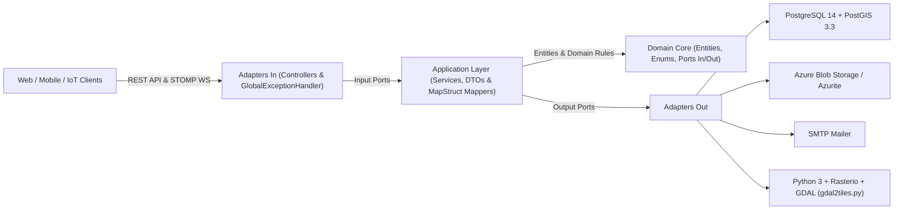

<div align="center">

# AgroTrack — Backend Platform

**Comprehensive agricultural, livestock, and multispectral remote sensing tracking system**

[](https://openjdk.org/)
[](https://spring.io/projects/spring-boot)
[](https://postgis.net/)
[](https://gdal.org/)
[](https://azure.microsoft.com/)
[](https://www.docker.com/)

*Hexagonal Architecture · REST API + STOMP WebSocket · Asynchronous Raster Processing · Multi-Tenant RBAC*

[Key Features](#-key-features) · [Tech Stack](#-tech-stack) · [Architecture](#-architecture) · [API & WebSockets](#-rest-api--websocket-surface) · [Deployment](#-quick-start--deployment) · [Environment Variables](#-environment-variables)

</div>

---

## What is AgroTrack?

**AgroTrack** is the backend platform responsible for centralizing productive, geospatial, and remote monitoring operations for agricultural and livestock farms (`AGRICULTURAL`, `LIVESTOCK`, and `MIXED`).

The service combines a **Spring Boot 4 / Java 21 REST API**, geospatial persistence on **PostgreSQL + PostGIS**, real-time communication via **WebSockets (STOMP)**, object storage in **Azure Blob Storage / Azurite** using presigned URLs (SAS), and an embedded **Python + GDAL / Rasterio** engine for generating map tiles from spectral maps captured by drones or satellites.

---

## Key Features

### Multi-Tenant Farm Management & RBAC
- Management of agricultural establishments (`farms`) with productive orientation (`AGRICULTURAL`, `LIVESTOCK`, `MIXED`), user invitations via email, and granular role assignment (`UserRole`):
  - `OWNER` · `AGRONOMIST` · `FOREMAN` · `APPLICATOR` · `VETERINARIAN` · `WORKER`

### Geospatial Cadastre with PostGIS
- Spatial modeling of farm and lot boundaries using Hibernate Spatial, Jackson JTS, and GeoAPI.
- Lot classification by land use (`PASTURE`, `WATER_ZONE`, `HANDLING_PEN`, `FEEDING_ZONE`, `AGRICULTURAL`, `RESERVE`) and soil type (`SANDY`, `CLAYEY`, `SILTY`, `LOAMY`, `SANDY_LOAM`, `CLAY_LOAM`, `UNKNOWN`).

### Multispectral Map & Remote Sensing Engine
- Support for spectral indices and layers (`SpectralMapType`): `RGB`, `NDVI`, `GNDVI`, `NDRE`, `OSAVI`, and `LCI`.
- Direct upload of raster files to object storage via a **presigned URL (SAS)** generated by the backend.
- Asynchronous Python pipeline (`scripts/MapProcessing.py`) powered by `rasterio`, `numpy`, `matplotlib`, and `gdal2tiles.py` to generate tile pyramids with traceable status lifecycle (`PENDING` -> `PROCESSING` -> `READY` / `ERROR`), retry support, and live notifications via WebSocket.

### Agricultural, Livestock & IoT Tracking
- **Crops:** registration per lot or unassigned, classification (`OILSEED`, `CEREAL`, `FORAGE`, `HORTICULTURAL`, `FRUIT`, `INDUSTRIAL`), phenological state transitions (`GERMINATION` -> `VEGETATIVE_GROWTH` -> `FLOWERING` -> `MATURITY` -> `HARVESTED`), and harvest logging.
- **Livestock & IoT:** management of animals (`BOVINE`, `BUFFALO`, `SWEEP`, `GOAT`, `PIG`, `HORSE`) and IoT collars (`AVAILABLE`, `ASSIGNED`, `MAINTENANCE`, `INACTIVE`) with dedicated endpoints for **GPS** location telemetry, **battery** level, and **operational state**.

### Field Operations, Tasks & Real-Time Alerts
- Creation and tracking of operational tasks (`MAINTENANCE`, `FERTILIZATION`, `FUMIGATION`, `HARVEST`, `IRRIGATION`, `PRUNING`) with priority levels (`LOW`, `MEDIUM`, `HIGH`, `CRITICAL`) and status workflow (`CREATED`, `IN_PROGESS`, `FINISH`).
- Upload of evidence images on tasks and alerts (`SYSTEM_AUTOMATIC` / `MANUAL_NOTE`, `NOTE` / `ALERT`) with geolocation and instant broadcasting to connected clients via **STOMP WebSocket**.

### Security & Resilience
- Stateless authentication with **JWT (`jjwt`)** and session renewal via **refresh token** (`/api/v1/auth/refresh`).
- Endpoint rate limiting with **Bucket4j**, declarative validation (`spring-boot-starter-validation`), environment-configurable CORS, and reverse-proxy header forwarding (`server.forward-headers-strategy=framework`).

---

## Tech Stack

| Layer | Technology | Version / Details |
| :--- | :--- | :--- |
| **Language & Runtime** | Java (Eclipse Temurin) | `Java 21` |
| **Core Framework** | Spring Boot | `4.0.3` (WebMVC, Validation, Mail, AMQP) |
| **Security** | Spring Security + JJWT + Bucket4j | `jjwt 0.12.5` · `bucket4j-core 8.1.0` |
| **Real-Time** | Spring WebSocket (STOMP) | Farm-scoped topics |
| **Persistence & GIS** | Spring Data JPA + Hibernate Spatial + PostgreSQL + PostGIS | `postgis/postgis:14-3.3` · `jackson-datatype-jts 1.2.10` · `geoapi 3.0.2` |
| **Blob Storage** | Azure Storage Blob SDK / Azurite | `azure-storage-blob 12.25.1` |
| **Geospatial Engine** | Python 3 + GDAL + Rasterio + NumPy + Matplotlib | `rasterio 1.3.9` · `numpy 1.26.4` · `matplotlib 3.8.3` · `gdal2tiles.py` |
| **Productivity & Mapping** | Lombok + MapStruct | `mapstruct 1.5.5.Final` |
| **Testing** | JUnit + Spring Security Test + Testcontainers | `testcontainers 1.19.7` (`postgresql`, `junit-jupiter`) |
| **Infrastructure** | Docker Multi-Stage + Docker Compose + Cloudflare Tunnel | `maven:3.9.6-eclipse-temurin-21-jammy` -> `eclipse-temurin:21-jre-jammy` |

---

## Architecture

The backend implements **Hexagonal Architecture (Ports and Adapters)**, decoupling the business core (`domain`) from use cases (`application`) and from transport, persistence, or external service details (`infrastructure`).



### Repository Structure

```text
AgroTrack/
├── .github/                              # Workflows and continuous integration
├── docs/specs/                           # Technical feature specifications
├── scripts/
│   └── MapProcessing.py                  # Raster processing and tile generation pipeline
├── src/
│   ├── main/
│   │   ├── java/com/agrotrack/
│   │   │   ├── domain/
│   │   │   │   ├── exception/            # Business exceptions
│   │   │   │   ├── model/
│   │   │   │   │   ├── entities/         # Pure domain entities
│   │   │   │   │   └── enums/            # Roles, phenological states, spectral types, etc.
│   │   │   │   └── port/
│   │   │   │       ├── in/               # Use cases per module
│   │   │   │       └── out/              # Persistence, storage, and messaging contracts
│   │   │   ├── application/
│   │   │   │   ├── dto/                  # Application data transfer objects
│   │   │   │   ├── mapper/               # MapStruct mappers
│   │   │   │   └── services/             # Use case implementations
│   │   │   └── infrastructure/
│   │   │       ├── config/               # Security, WebSocket, CORS, and Spring configuration
│   │   │       ├── security/             # JWT filters, user details, and rate limiting
│   │   │       └── adapters/
│   │   │           ├── in/web/           # 11 REST Controllers + DTOs + GlobalExceptionHandler
│   │   │           └── out/              # JPA/PostGIS, Azure Blob Storage, Email, and Lot adapters
│   │   └── resources/
│   │       └── application.properties    # Base configuration and environment placeholders
│   └── test/                             # Unit and integration tests with Testcontainers
├── Dockerfile                            # Multi-stage build: Java 21 + Python venv + GDAL
├── docker-compose.yml                    # Full stack orchestration (PostGIS, Azurite, Back, Front, Cloudflared)
├── pom.xml                               # Maven dependencies and build plugins
└── requirements.txt                      # Python geospatial engine dependencies
```

---

## REST API & WebSocket Surface

All HTTP resources are versioned under the `/api/v1` prefix and handle errors centrally through `GlobalExceptionHandler`.

| Module / Controller | Base Path | Primary Responsibility |
| :--- | :--- | :--- |
| `AuthController` | `/api/v1/auth` | Login (`POST /login`), token renewal (`POST /refresh`), registration, and invitation acceptance |
| `UserController` | `/api/v1/users` | Authenticated profile (`/me`) and user management |
| `FarmController` | `/api/v1/farms` | Creation, querying, and management of agricultural farms |
| `FarmUserController` | `/api/v1/farms/{farmId}/users` | Farm member and RBAC role administration |
| `LotController` | `/api/v1/lots` | Creation, editing, and spatial querying of lots |
| `CropController` | `/api/v1` | Crops (`/crops/farm/{farmId}`, `/crops/unassigned`, `/crops/{id}`), lot planting (`POST /lots/{lotId}/crops`), phenological state (`PUT /crops/{cropId}/phenological-state`), and harvesting (`POST /crops/{cropId}/harvest`) |
| `AnimalController` | `/api/v1/animals` | Livestock registration and tracking by farm and species |
| `IoTCollarController` | `/api/v1/farms/{farmId}/collars` & `/api/v1/collars/{collarId}` | IoT collar management and telemetry ingestion (`/gps`, `/battery`, `/state`) |
| `TaskController` | `/api/v1/tasks` | Operational task management, image upload (`POST /images`), and status updates with notes/evidence (`PATCH /{taskId}/status`) |
| `AlertController` | `/api/v1/alerts` | Georeferenced alerts and field notes with photo attachments |
| `SpectralMapController` | `/api/v1/farms/{farmId}/maps` | Presigned SAS URL issuance for raster upload, map registration, querying, and processing retry |

### WebSocket Topics (STOMP)

| Topic | Published Events |
| :--- | :--- |
| `/topic/farms/{farmId}/tasks` | Real-time status changes and task updates for the farm |
| `/topic/farms/{farmId}/maps` | Spectral map processing/tiling progress and status updates |

---

## Quick Start & Deployment

### Option 1: Full Stack with Docker Compose

The [`docker-compose.yml`](docker-compose.yml) file spins up the integrated infrastructure on the `agrotrack-net` network:

| Service | Container | Image / Build | Host Port |
| :--- | :--- | :--- | :--- |
| **PostgreSQL + PostGIS** | `agrotrack-postgres-azuretest` | `postgis/postgis:14-3.3` | `5433` -> `5432` |
| **Azure Blob Emulator** | `agrotrack-azurite-azuretest` | `mcr.microsoft.com/azure-storage/azurite` | `10000-10002` |
| **AgroTrack Backend** | `agrotrack-backend-azuretest` | Built from `Dockerfile` | `8080` -> `8080` |
| **AgroTrack Frontend** | `agrotrack-frontend-azuretest` | Context `../../Front 1/front-agrotrack` (`production`) | `4200` -> `80` |
| **Cloudflare Tunnel** | `cloudflared-azuretest` | `cloudflare/cloudflared:latest` | Outbound tunnel |

```bash
# Build and start all services in the background
docker compose up -d --build

# Follow backend logs
docker compose logs -f backend-azuretest
```

> **Dockerfile Note:** The production runtime image (`eclipse-temurin:21-jre-jammy`) bundles `/opt/venv` with `rasterio`, `numpy`, and `matplotlib`, `gdal-bin` binaries (`/usr/bin/gdal2tiles.py`), the `/app/scripts/MapProcessing.py` script, and timezone set to `America/Argentina/La_Rioja`.

### Option 2: Local Development Execution

**Prerequisites:** JDK 21, Maven 3.9+, PostgreSQL with PostGIS extension, Azure Blob Storage or Azurite, and Python 3 with `gdal` plus the packages in `requirements.txt` if processing spectral maps locally.

```bash
# 1. Install Python dependencies for the raster engine (optional for local map processing)
pip install -r requirements.txt

# 2. Compile and run tests
mvn test

# 3. Start the Spring Boot application on port 8080
mvn spring-boot:run
```

---

## Environment Variables

Configure external credentials and paths via environment variables (never commit real secrets to the repository):

| Variable / Property | Description | Default / Example |
| :--- | :--- | :--- |
| `SPRING_DATASOURCE_URL` | PostgreSQL/PostGIS JDBC connection string | `jdbc:postgresql://localhost:5433/agrotrack` |
| `SPRING_DATASOURCE_USERNAME` | Database username | `<DB_USER>` |
| `SPRING_DATASOURCE_PASSWORD` | Database password | `<DB_PASSWORD>` |
| `AZURE_STORAGE_CONNECTION_STRING` | Azure Blob Storage or Azurite connection string | `<AZURE_CONNECTION_STRING>` |
| `AZURE_STORAGE_CONTAINER_NAME` | Blob container name for maps and images | `agrotrack-files` |
| `PYTHON_EXEC` | Python binary invoked by the map processor | `python3` |
| `PYTHON_SCRIPT_PATH` | Path to the raster processing script | `/app/scripts/MapProcessing.py` |
| `GDAL_SCRIPT_PATH` | Path to `gdal2tiles.py` for tile generation | `/usr/bin/gdal2tiles.py` |
| `CORS_ALLOWED_ORIGINS` | Allowed CORS origins (`cors.allowed-origins`) | `https://your-domain.com,http://localhost:4200` |

**Key limits and parameters in `application.properties`:**
- `server.port`: `8080`
- `spring.servlet.multipart.max-file-size`: `10MB` · `max-request-size`: `25MB`
- `jwt.expiration`: `604800000` (7 days)

**Límites y parámetros clave en `application.properties`:**
- `server.port`: `8080`
- `spring.servlet.multipart.max-file-size`: `10MB` · `max-request-size`: `25MB`
- `jwt.expiration`: `604800000` (7 días)
